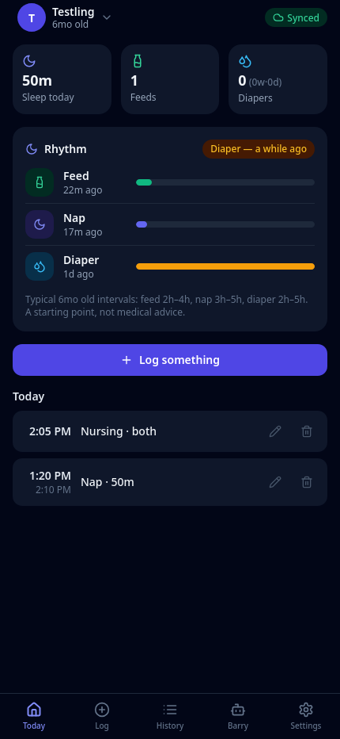
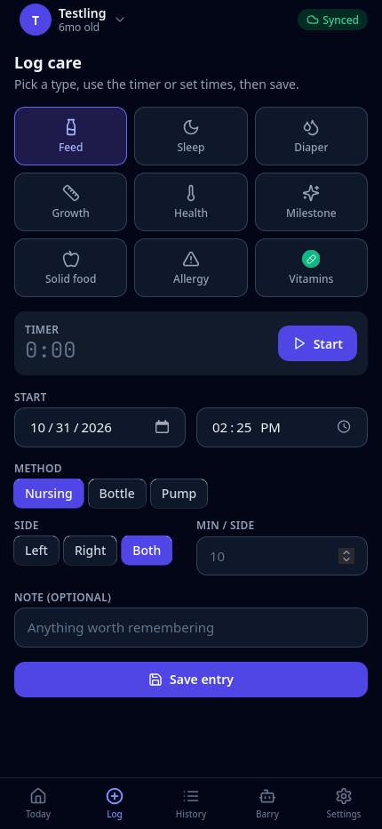
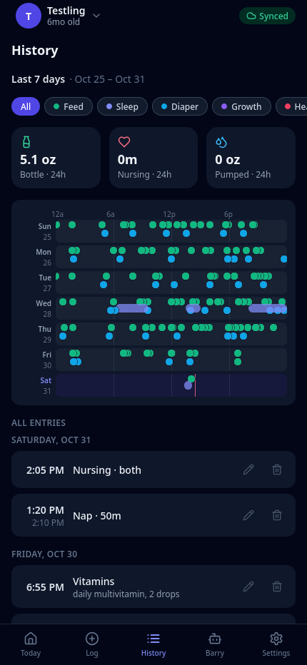
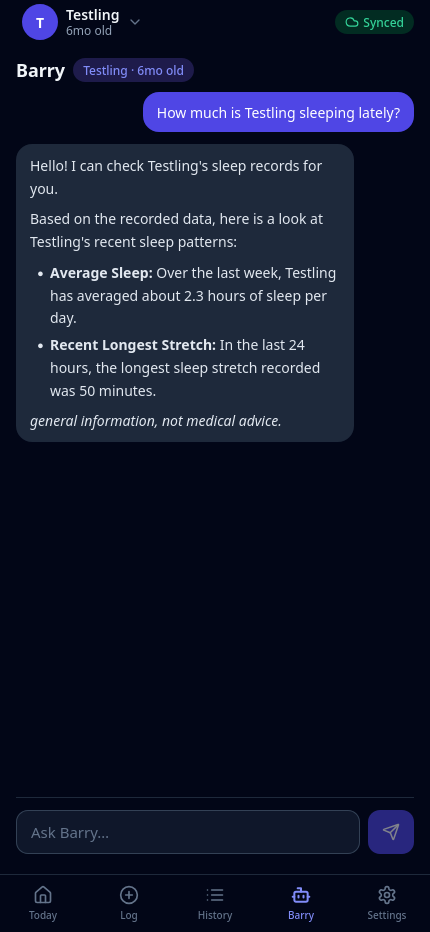
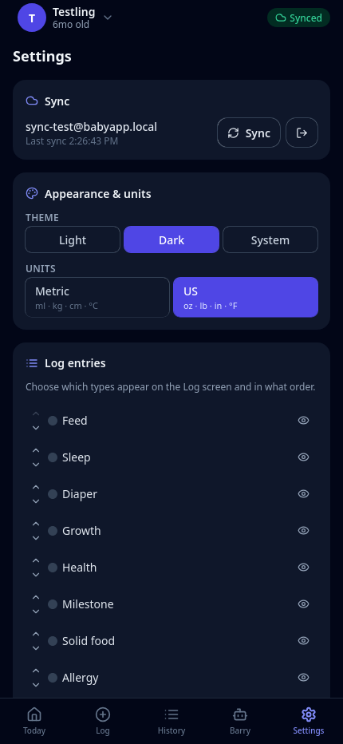

# Cadence

Cadence is a baby care app. It is a web app (PWA). You can install it on the home screen of your phone. The app works without a network connection. It stores the data on the phone. When you add a backend, it can sync between two caregivers.

The app records:

- Feeds (nursing, bottle, solid food)
- Sleep (naps and night sleep, with a live timer)
- Diapers
- Growth (weight, length, head circumference)
- Health (temperature, symptoms, medicine)
- Milestones
- Allergy reactions
- Contractions
- Custom events (vaccines, appointments)
- Notes

Optional:

- Sync to a Supabase backend
- Barry, an AI assistant

> This app is a care tracking tool. It is not a medical device and it is not a medical service. It does not give medical advice. For anything health related, talk to your doctor.

## Screenshots



Today: the totals for the day and the timeline.



The log form.



History: the timeline grouped by day.



Barry answers from the recorded data and lists its sources.



Settings: the profile, sync, and Barry.

## Features

- Offline first: the data lives in IndexedDB on the phone. The app works with no backend and no network.
- Multi-child: switch between babies. All data is per-child.
- Rhythm: shows how long it has been since the last entry of each type. It compares feeds, naps, and diapers to the typical interval for the baby's age. It is a starting point, not medical advice.
- Today dashboard: the totals for sleep, feeds, and diapers, and the timeline for the day.
- History: the full timeline grouped by day, in your local time.
- Data ownership: export a child as JSON or CSV. Delete an entry, a child (its data is deleted too), or all of your data.
- PWA: installable, works offline, maskable icons.
- Sync (optional): two caregivers share one timeline.
- Barry (optional): an AI assistant that answers from the recorded data. See [Barry](#barry).

## Tech stack

| Layer | Choice |
|---|---|
| UI | React 18, TypeScript, Vite, Tailwind CSS |
| PWA | vite-plugin-pwa (Workbox) |
| State | Zustand |
| Local database | IndexedDB (idb) |
| Backend | Supabase (Postgres, Auth, RLS, Edge Functions), optional |
| Sync | Push/pull over Supabase, last-write-wins, per-group watermarks |
| AI (Barry) | Supabase Edge Function (Deno), RAG over a pgvector corpus |
| Web search (Barry) | SearXNG |

## Build

### Requirements

- Node.js 22 or later
- npm
- Docker and Docker Compose v2 (only for the backend)

### Development server

```bash
npm install
npm run dev
```

The app runs at http://localhost:5173.

The app works without a backend. Add a baby in onboarding, then log care. The data stays on the device.

### Icons

```bash
npm run icons
```

The script converts the SVGs in `docs/icons/` into the icons in `public/icons/`. The icons are already committed.

### Production build

```bash
npm run build
npm run preview
```

The build checks the types, then writes the app to `dist/` (with the service worker).

The build reads `VITE_SUPABASE_URL` and `VITE_SUPABASE_ANON_KEY` from the environment. It writes the two values into the app bundle at build time. To change the backend, set the values and rebuild.

## Test

The project has no automated test suite.

Run these checks after a change:

```bash
npm run typecheck
npm run build
```

Then test the app by hand.

### Manual test list

1. Open the app. The Today tab shows.
2. Log a feed. The entry appears in Today.
3. Log a nap. The entry appears in Today.
4. Edit the entry. The change saves.
5. Delete the entry. It disappears from Today and History.
6. Open History. The entries group by day, in local time.
7. Open Growth. Add a weight. The chart updates.
8. Open Settings. Change the app name. The change saves.
9. With a backend, the sync badge shows the connection state.

## Deploy

You have three options.

- Option 1: a local Docker stack (recommended)
- Option 2: the same stack on a server
- Option 3: a hosted Supabase project (no Docker)

### Option 1: Local Docker stack

Requirements:

- A Linux host (Ubuntu or Debian)
- Docker Engine and Docker Compose v2
- About 4 to 6 GB of free RAM

Run:

```bash
make setup
```

The script does the following:

1. Generates `docker/supabase/.env` with random secrets and JWT keys. It keeps existing `.env` files.
2. Generates the root `.env`. It points `VITE_SUPABASE_URL` and `VITE_SUPABASE_ANON_KEY` at the local stack. It keeps values you set by hand.
3. Syncs the env files (`scripts/sync-env.sh`).
4. Copies `supabase/functions/*` (Barry) into the edge-runtime volume.
5. Builds the web image with the local URL and the anon key in the bundle.
6. Starts the stack and waits for the services to be healthy.
7. Applies `supabase/migrations/*.sql`.

The stack runs at:

| Service | URL |
|---|---|
| Cadence (web app) | http://localhost:8088 |
| Supabase API (Kong) | http://localhost:8000 |
| Supabase Studio | http://localhost:8000/studio |
| Postgres | localhost:5432 |
| SearXNG (Barry web search) | http://localhost:8888 |

The Studio user and password are in `docker/supabase/.env` (`DASHBOARD_USERNAME` and `DASHBOARD_PASSWORD`).

You can change these ports in the root `.env`:

| Variable | Default |
|---|---|
| `WEB_PORT` | 8088 |
| `KONG_HTTP_PORT` | 8000 |
| `KONG_HTTPS_PORT` | 8443 |
| `POSTGRES_PORT` | 5432 |
| `POOLER_PROXY_PORT_TRANSACTION` | 6543 |
| `SEARXNG_PORT` | 8888 |

Commands for every day:

| Command | What it does |
|---|---|
| `make up` | Build (if needed) and start |
| `make down` | Stop (keeps the data) |
| `make restart` | Restart all services |
| `make ps` | Show the status |
| `make logs` | Tail all logs |
| `make build` | Rebuild the web image |
| `make migrate` | Re-apply the migrations (safe) |
| `make sync-functions` | Copy Barry into the edge runtime |
| `make deploy-barry` | Sync the functions and restart the edge runtime |
| `make studio` | Show the Studio URL |
| `make reset` | Stop and destroy all local data |

`make reset` is dangerous. It deletes the database, the volumes, and the generated `.env` files.

#### Barry setup (Docker)

Put your LLM endpoint in the root `.env`:

```
BARRY_BASE_URL=...
BARRY_API_KEY=...
BARRY_MODEL=...
```

Then run `make deploy-barry`. Any OpenAI-compatible endpoint works. This includes a local server (Ollama, LM Studio, vLLM).

Without these values, the app still works. Barry shows an offline notice.

#### How the env files work

Docker Compose reads `${VAR}` from the root `.env` only. It does not read `docker/supabase/.env`. So:

- `make setup` writes the stack secrets into `docker/supabase/.env`.
- `scripts/sync-env.sh` copies every stack variable into a managed block at the end of the root `.env`.
- Your `BARRY_*` values go the other way (from the root `.env` to the stack file).
- Do not edit the managed block. It gets overwritten.
- To change a stack variable, edit `docker/supabase/.env`, then run `make up`.
- The make targets are the supported way to run the stack. A direct `docker compose up` also works, after a setup or `make up`.

#### Troubleshooting

| Symptom | Fix |
|---|---|
| Many services fail at start. Postgres says "password is not specified". | The stack started before `make setup` generated the `.env` files. The secrets are blank. If the database already started with blank secrets, run `make reset`, then `make setup`. |
| "port is already allocated" | Another program uses 8000, 8443, 5432, 6543, or 8088. Change the port variables in the root `.env`. Then run `make setup` and `make up`. |
| "container name ... is already in use" | Old containers from another compose project. Run `make reset`. |
| Services stop with out-of-memory errors | The stack needs about 4 to 6 GB of RAM. Raise the memory limit of the Docker daemon. |
| Studio asks for a password | The user and password are in `docker/supabase/.env`. |

### Option 2: A server

The same compose project runs on a virtual server (VPS) or a home server.

1. Copy the repo to the server.
2. Set these variables in `docker/supabase/.env`:
   - `KONG_HTTP_PORT` and `WEB_PORT` (the ports)
   - `SUPABASE_PUBLIC_URL` (the public URL of the API)
   - `API_EXTERNAL_URL` (the public URL of the API)
   - `SITE_URL` (the public URL of the web app)
3. Run `make setup` (or `make up`) to apply the values.
4. Put a TLS reverse proxy in front (Caddy or nginx). Example (Caddy):

   ```
   babies.example.com {
     reverse_proxy localhost:8088
   }

   api.babies.example.com {
     reverse_proxy localhost:8000
   }
   ```

5. Rebuild the web image so the bundle points at the public URL:

   ```bash
   docker compose up -d --build web
   ```

6. Run `make up`.

The Supabase services use a pinned tag (`v1.26.08`) in `docker/supabase/`. To change the version, edit the tag. This keeps an upgrade a manual, reviewed change.

### Option 3: Hosted Supabase

You do not need Docker.

1. Create a project at [supabase.com](https://supabase.com). The free tier is enough.
2. Apply the schema (SQL editor, or `supabase db push`):
   - `supabase/migrations/0001_init.sql` (tables, RLS, sync functions)
   - `supabase/migrations/0002_barry_corpus.sql` (pgvector, Barry corpus)
   - `supabase/migrations/0003_custom_events.sql` (custom event types)

   A trigger creates a care group for each user on signup.
3. Copy `.env.example` to `.env`. Fill in:

   ```
   VITE_SUPABASE_URL=https://<project>.supabase.co
   VITE_SUPABASE_ANON_KEY=<anon key>
   ```
4. Deploy Barry:

   ```bash
   supabase functions deploy barry --no-verify-jwt
   supabase secrets set \
     BARRY_BASE_URL="https://api.openai.com/v1" \
     BARRY_API_KEY="sk-..." \
     BARRY_MODEL="gpt-4o-mini"
   ```

   - Any OpenAI-compatible `BARRY_BASE_URL` works (example: Ollama at `http://host:11434/v1`).
   - `BARRY_EMBEDDING_MODEL` is optional (example: `text-embedding-3-small`). Without it, Barry uses keyword search over the corpus. With it, the function fills in the corpus embeddings on first use. The column is `vector(384)`. If your model uses another size, recreate the column to match.
   - `BARRY_SEARXNG_URL` is optional. Set it to a reachable SearXNG instance if you want Barry to search the web. If SearXNG is not reachable, Barry answers from the corpus and the recorded data, and it says so.
5. Rebuild the app so the new values go into the bundle:

   ```bash
   npm run build
   ```
6. Host the `dist/` folder (Netlify, Vercel, or any static host).
7. Sign in under Settings, Sync. The devices start to sync.

## How sync works

- The phone is the source of truth. Every change writes to IndexedDB first.
- Push: the app waits about 1 second after a change, then upserts the rows with the database functions `upsert_children` and `upsert_events`. The newest `updated_at` wins.
- The app also syncs when you open it, and when the network returns.
- Pull: the app pulls the rows of your group that are newer than the watermark. It merges them locally (newest wins). It stores a watermark per group (the newest `updated_at` seen).
- Deletes are soft (`deleted = true`). They sync like other changes. "Delete all my data" removes the data on the server and signs you out.
- Access control: row-level security (RLS) and the `group_members` table. A user sees only their own care group.

## Barry

Barry is an optional AI assistant. It runs as a Supabase Edge Function (`supabase/functions/barry/`).

How it works:

1. The app sends the question and the child's context. The context has the last 24 hours of entries in detail, the 7-day averages, and the latest growth, health, and milestone entries.
2. Barry searches its reference corpus (RAG over pgvector).
3. Barry searches the web with SearXNG. It keeps the results that are clearly about babies.
4. Barry builds a prompt from the notes, the web results, and the child's context.
5. Barry sends the prompt to your LLM (any OpenAI-compatible API) and streams the answer to the app. The app shows the sources.

Settings (function secrets):

| Variable | Meaning |
|---|---|
| `BARRY_BASE_URL` | The LLM API base URL |
| `BARRY_API_KEY` | The LLM API key |
| `BARRY_MODEL` | The model name |
| `BARRY_SEARXNG_URL` | The SearXNG instance (default: `http://searxng:8080`) |
| `BARRY_EMBEDDING_MODEL` | Optional. The embedding model |

The API key stays on the server. The phone never sees the key.

If the function is not configured, it returns an error (503). The rest of the app works normally.

## Project layout

```
src/
  lib/          types, config, IndexedDB, store (Zustand), sync,
                rhythm, Barry client, export utils
  components/   layout, child switcher, event form/card, rhythm card, stats
  pages/        Onboarding, Today, Log, Timeline, Barry, Settings
supabase/
  migrations/   0001_init.sql, 0002_barry_corpus.sql, 0003_custom_events.sql
  functions/barry/  RAG + streaming edge function (Deno)
docker/
  Dockerfile    web image (Vite build, served by nginx)
  nginx/        nginx config (sw.js no-cache, hashed assets immutable)
  supabase/     pinned self-hosted Supabase stack (tag v1.26.08)
docker-compose.yml  root project: web + included supabase stack
scripts/
  setup-docker.sh     env generation, build, up, health waits, migrations
  apply-migrations.sh (re)apply supabase/migrations (safe)
  sync-functions.sh   supabase/functions/* to the edge-runtime volume
  sync-env.sh         copy stack vars into the root .env
  generate-icons.mjs  SVG to PNG/WebP icons
Makefile          make setup / up / down / logs / migrate / reset ...
docs/
  icons/        source icons (SVG)
  screenshots/  images for this README
```

## Roadmap

- Weekly reports and charts (growth curves)
- Reminders and alarms (Web Push)
- Voice entry (Web Speech) and photo capture on events
- Schedule creator
- Smartwatch, lock-screen, and background-timer companions (native work)
